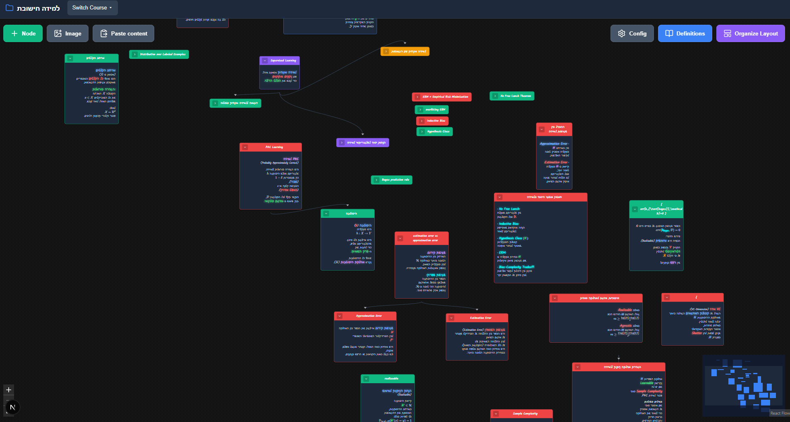

# Mind Map

A study mind-map app built with Next.js. Organize each course as an interactive map of nodes with Markdown and math notes, handwriting-style fonts, a drawing pad, and AI help from Google Gemini.



## Features

- **Courses** — each course is its own mind map, saved as JSON in `data/`
- **Interactive canvas** — drag, connect, collapse and auto-layout nodes (React Flow + dagre)
- **Rich notes** — Markdown, GFM tables and LaTeX math (KaTeX), plus Typst snippets rendered to SVG
- **Draw pad** — sketch or write by hand inside a node
- **Gemini AI** — OCR/transcription and summarization, with key rotation across several API keys and fallback to lower models when quota runs out
- **Hebrew handwriting fonts** and an installable PWA manifest

## Getting started

Requirements: Node.js 20+. Optional: [Typst](https://typst.app) on your `PATH` for Typst snippets.

```bash
npm install
cp .env.example .env.local   # then add your Gemini API key(s)
npm run dev
```

Open [http://localhost:3000](http://localhost:3000).

### Environment variables

| Variable | Description |
| --- | --- |
| `GEMINI_API_KEYS` | One or more Gemini API keys, comma-separated |
| `GEMINI_MODEL` | Optional default model (defaults to `gemini-3.6-flash`) |
| `ALLOWED_DEV_ORIGINS` | Optional comma-separated hosts (LAN / Tailscale) allowed to open the dev server |

`.env.local` is git-ignored. Never commit real keys.

## Project structure

```
app/            Pages and API routes (courses, mindmap, models, summarize, typst)
components/     MindMap, StudyNode, DrawPad, DefinitionsPanel
lib/            Gemini client, course storage, fonts, Markdown/math helpers
data/           Your course files (git-ignored, created at runtime)
mcp-latex-server/  Optional MCP server for compiling LaTeX
```

## Scripts

- `npm run dev` — start the dev server
- `npm run build` — production build
- `npm start` — run the production build
- `npm run lint` — lint
